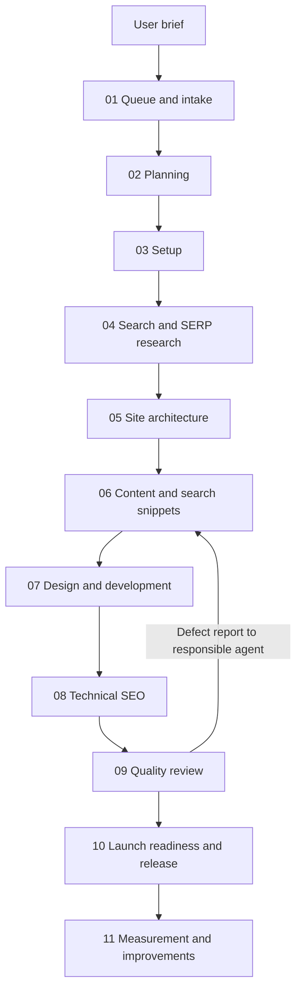

# Agentic SEO Website Workflow

**Desktop interface:** double-click `Agentic Studio.exe` or `Start-Agentic.cmd`. The native Windows app has a 3D operations room, real queue counters, clickable stations, task creation, brief editing, and a live task inspector. See [desktop instructions](desktop/README.md). AI execution still requires a coding agent; the UI does not launch AI workers.

A sequential workflow for turning a user brief into a useful, search-friendly website, then improving organic search click-through rate (CTR) using observed results. Rankings, indexing, rich results, and CTR gains are goals, never guaranteed deliverables.

## Fresh checkout

Install Node.js 18 or newer and run `npm test`; no npm install is needed. On Windows, run `powershell -ExecutionPolicy Bypass -File desktop/build.ps1`, then double-click `Start-Agentic.cmd`. The desktop uses the Windows .NET Framework compiler. Create a new task to populate the queue. Private jobs, generated executables, and locally deployed sites are excluded from this repository. The full template library is included with its provenance; third-party materials retain their original terms.

## Start here

After creating a desktop task, the **Start your task** dialog opens automatically. Click **Copy task instructions**, paste into your coding agent with this workspace open, and send. The inspector's **Start / continue task** button reopens these instructions. The desktop tracks real queue updates; copying instructions alone does not launch a worker.

**Affiliate links:** enter the destination, button text, and placement in New task or Edit brief. Use `auto` for the agent to select relevant CTA locations. See [affiliate placement instructions](templates/AFFILIATE-LINKS.md).

**Blog agent:** enable **Create blog posts**, supply topics or let the agent research them, choose the post count and blog path. **Add blog task** starts a separate draft for the selected site's existing source. You can add multiple affiliate destinations with **Add affiliate link**, including placements in specific articles. See [blog workflow](templates/BLOG-WORKFLOW.md).

**Bring your own copy:** the desktop **Content writer** editor supports exact user content, automatic page/section placement, and hybrid copy with agent-written gap sections. The queue verifies placement evidence and rescans built HTML for missing or changed wording. See [user-content instructions](templates/USER-CONTENT.md).

**All 13 template sources are installed.** New tasks now choose a design automatically from the brief and save the reason plus ranked alternatives. Planning can refine the choice; an explicit template ID takes priority. See [template library instructions](templates/TEMPLATE-LIBRARY.md) or run `npm run templates` to verify the complete local library.

Website design now starts from the user's [template gallery](https://igaming-templates.vercel.app). New briefs default to `design_template_id: "auto"`; set a catalog ID such as `t2` to request a specific design. Development must reuse actual downloaded template source and save provenance/checksum/adaptation evidence before the queue accepts stage 07. The gallery choices are listed in `config/template-catalog.json`.

1. Copy `templates/brief.json`, fill in the project details, and save your copy.
2. Initialize a job: `node workflow.mjs init --brief templates/brief.json --job jobs/my-site`
3. Give your agent runner `ORCHESTRATOR.md` and the job directory. It should claim the next task, read that task's agent instructions, do the work, save the deliverable, and complete the task.
4. Inspect progress: `node workflow.mjs status --job jobs/my-site`

The Node.js tool is a local queue and handoff tracker. It does not call a model, launch autonomous agents, build a website, or publish anything by itself. An agent runner or a human follows the instructions and invokes the commands. Node.js 18+; no packages, credentials, or paid services required for queue management.

## The sequence



The defect arrow is a remediation path: reopen the responsible stage in the queue, which invalidates all later stages for revalidation. The queue follows the numbered sequence again. There is one active task per job; use separate job directories for separate websites.

## Queue commands

```text
node workflow.mjs next --job jobs/my-site
node workflow.mjs claim --job jobs/my-site --agent planning-agent
node workflow.mjs complete --job jobs/my-site --agent planning-agent
node workflow.mjs fail --job jobs/my-site --agent planning-agent --reason "Missing required domain decision"
node workflow.mjs retry --job jobs/my-site
node workflow.mjs reopen --job jobs/my-site --stage 06 --reason "QA found unsupported claims"
```

`next` shows the first unfinished stage and its agent. `claim` only accepts that agent. Save its JSON deliverable at the printed artifact path before completing it. See `templates/deliverable.json`. Failed work stops the queue; retry explicitly after resolving the issue. Reopening a stage preserves existing artifact files as drafts but resets that stage and every later task. Revalidate and replace stale drafts before completing them.

Completion validates the handoff format and referenced evidence files. It cannot judge whether the content or website is good. The quality agent must inspect the actual website and evidence. A missing browser, search tool, credentials, or measurement data must be recorded as a limitation, not described as a passed check.

## What to provide

The brief captures the business, audience, language, market, offer, conversion goal, domain, technology preferences, assets, and evidence supporting claims. Unknown details may remain blank. Intake distinguishes safe assumptions from blocking decisions. A first implementation can use a preview domain; launch canonical URLs require the real production domain.

The standard artifacts include a prioritized plan, setup record, dated SERP research, page/keyword map, finished copy and snippet candidates, working website, technical SEO report, QA evidence, release record, and measurement plan. Artifacts live under each job's `artifacts/` directory; implementation files belong in the project path established by setup.

## Search principles

Build useful pages with accurate claims and distinct intent. Use descriptive titles and snippets that match visible content. Search engines may choose different title links and snippets. Only use structured data that truthfully describes the page, and check current eligibility before choosing a type. Never invent reviews, expertise, keyword volumes, competitors' metrics, or results.

CTR means organic clicks divided by organic impressions. Compare query/page/device/country segments and account for changes in position, demand, and query mix; raw before/after CTR is not proof of causation. Track conversions alongside clicks. A new site without Search Console history gets an instrumentation and follow-up plan, not invented performance data.

Sources consulted November 16, 2026; agents must recheck relevant guidance when executing:

- [Google Search Essentials](https://developers.google.com/search/docs/essentials)
- [Helpful, reliable, people-first content](https://developers.google.com/search/docs/fundamentals/creating-helpful-content)
- [Title links](https://developers.google.com/search/docs/appearance/title-link)
- [Snippets](https://developers.google.com/search/docs/appearance/snippet)
- [Structured data guidelines](https://developers.google.com/search/docs/appearance/structured-data/sd-policies)

See `ORCHESTRATOR.md` for the control loop and `agents/roles.md` for each agent's responsibilities and acceptance checks.
